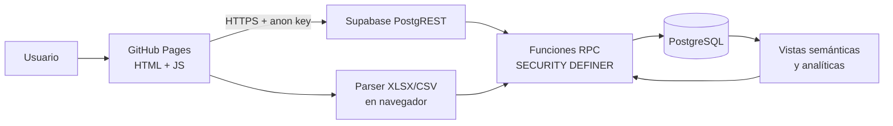
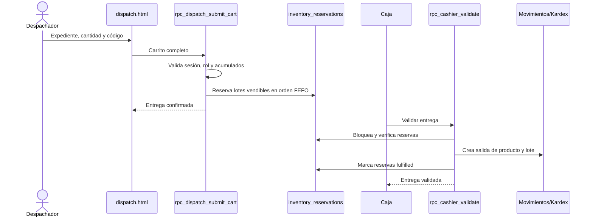

# Arquitectura técnica de Botiquín CCM

## 1. Resumen del sistema

Botiquín CCM es una aplicación web interna de operación farmacéutica. Controla
medicamentos y dispositivos no farmacéuticos sin mezclarlos en el modelo de
inventario. Sus procesos principales son:

- consulta pública de disponibilidad;
- catálogo farmacéutico y precios de referencia;
- importación de compras, ventas, consultas e inventario del ERP;
- inventario físico, vendible, vencido y reservado;
- despacho de medicamentos y validación posterior por Caja;
- salida serializada de dispositivos y validación por Caja;
- conteos físicos, diferencias, ajustes, devoluciones y Kardex;
- análisis de ventas, margen, vencimientos y compra sugerida;
- seguimiento del resultado del ofrecimiento de medicamentos.

La integridad de inventario es responsabilidad del backend. La interfaz guía al
usuario, pero las RPC vuelven a validar sesión, rol, existencia, estado y
cantidades antes de escribir.

## 2. Stack y topología

| Capa | Tecnología | Responsabilidad |
| --- | --- | --- |
| Presentación | HTML, CSS, JavaScript vanilla y Bootstrap | Pantallas, formularios, tablas y navegación |
| Archivos | SheetJS en el navegador | Lectura de XLSX/CSV antes de enviar filas normalizadas |
| Backend | Supabase PostgREST y funciones PostgreSQL | Contratos RPC, autorización y transacciones |
| Datos | PostgreSQL | Catálogos, eventos, inventario, auditoría y analítica |
| Autenticación operativa | PIN propio + `app_sessions` | Sesiones de admin, despacho y caja |
| Hosting | GitHub Pages | Publicación de los archivos estáticos |
| Versionamiento | Git + migraciones en `supabase/sql/` | Historial reproducible de cambios |



No existe servidor de aplicación propio entre GitHub Pages y Supabase. Por eso
las funciones y políticas de base de datos son el límite de confianza real.

## 3. Organización del frontend

Cada módulo es una página HTML autónoma. Los recursos compartidos son:

- `app-nav.js` / `app-nav.css`: navegación coherente por dominio y rol.
- `app-session.js`: bloqueo inicial, validación, renovación y expiración.
- `app-time.js`: presentación en zona `America/El_Salvador`.

Las pantallas públicas son `index.html` y `availability.html`. Las demás declaran
roles permitidos, cargan el guard de sesión y esperan la respuesta del servidor
antes de mostrar controles o datos.

### 3.1 Estructura del repositorio

| Ruta | Contenido |
| --- | --- |
| `*.html` | Módulos funcionales; cada página incluye su lógica de presentación |
| `app-*.js`, `app-*.css` | Navegación, tiempo y control de sesión compartidos |
| `supabase/sql/` | Migraciones incrementales y contratos RPC |
| `tests/` | Validadores estáticos y smokes de navegador |
| `tests/sql/` | Consultas de invariantes y comprobaciones de migraciones |
| `docs/` | Arquitectura y procedimientos operativos |
| `integraciones/` | Artefactos auxiliares de análisis; no es la fuente de producción |

La lógica JavaScript aún vive principalmente dentro de cada HTML. Esto mantiene
el despliegue simple, pero obliga a vigilar duplicación en llamadas RPC, manejo
de errores, paginación y exportación.

## 4. Dominios funcionales

### 4.1 Identidad y autorización

`app_users` conserva usuario, rol, PIN protegido y estado. `app_sessions`
conserva el hash del token, expiración y revocación. El navegador guarda el token
y datos mínimos de interfaz en `localStorage`, pero una copia local no autoriza
ninguna escritura.

Roles operativos:

- `admin`: configuración, importaciones, reportes, auditoría y correcciones.
- `dispatch`: despacho de medicamentos y dispositivos.
- `cashier`: validación u observación de entregas.

`rpc_pin_login` crea la sesión y `rpc_session_touch` valida/renueva su vigencia.
Las pantallas protegidas permanecen bloqueadas durante esa comprobación. Una
falla de red bloquea temporalmente la UI sin asumir que el token fue revocado.

### 4.2 Catálogo farmacéutico y analítica ERP

`medicines` es la ficha maestra. Compras, ventas, consultas e inventarios
importados se conservan en tablas normalizadas y mantienen procedencia mediante
archivo, lote de importación y número de fila.

Los datos de ventas importados alimentan análisis histórico de facturación,
utilidad, margen y rotación. No son el movimiento operativo que descuenta el
inventario de la aplicación.

### 4.3 Inventario farmacéutico

La cantidad actual no vive en un único campo editable. Se reconstruye desde:

1. el último `inventory_snapshots` importado;
2. sus `inventory_snapshot_items`;
3. los movimientos posteriores de `inventory_movements`;
4. los lotes y sus movimientos en `inventory_lot_movements`;
5. las reservas activas de despachos confirmados.

Las vistas semánticas exponen nombres explícitos:

- `physical_qty`: existencia física calculada;
- `expired_qty`: física, pero vencida;
- `reserved_qty`: física comprometida por un despacho;
- `quarantine_qty`: física retenida;
- `not_sellable_qty`: física no apta por otra causa;
- `sellable_qty`: disponible para despacho.

La ecuación vigente es:

```text
sellable_qty = max(
  physical_qty - expired_qty - reserved_qty
  - quarantine_qty - not_sellable_qty,
  0
)
```

`quarantine_qty` y `not_sellable_qty` están previstos por la capa semántica; su
uso depende de que existan retenciones operativas registradas. Nunca deben
interpretarse como movimientos físicos si solo representan un estado lógico.

### 4.4 Despacho de medicamentos y Caja

El flujo actual reserva inventario al confirmar el carrito y lo descuenta al
validar en Caja:



Reglas:

- el carrito agrega por código canónico y valida la suma acumulada;
- la asignación usa FEFO: `expires_at ASC, lot_no ASC`;
- lotes vencidos o no vendibles nunca son candidatos;
- la reserva evita ofrecer a otro despacho las mismas unidades;
- validar, observar o anular se ejecuta mediante RPC transaccional;
- un despacho validado se anula con movimientos compensatorios, no borrando el
  historial;
- una corrección parcial conserva cantidad original, motivo y devolución al lote
  consumido cuando corresponde.

### 4.5 Conteos, diferencias y ajustes

Un conteo congela el esperado al abrir la sesión. Registrar o finalizar el conteo
es evidencia y no cambia inventario. La diferencia genera un expediente separado:

1. primer conteo;
2. segundo conteo por una persona distinta;
3. diferencia confirmada;
4. ajuste de stock opcional por admin;
5. investigación y resolución administrativa.

El estado del ajuste y el estado de la investigación son independientes. Dar un
faltante por pérdida sí crea la salida administrativa correspondiente; encontrar
el producto puede crear una entrada de recuperación. El conteo original no se
reescribe.

### 4.6 Devoluciones a proveedor

El borrador no mueve inventario. `Aplicar salida` registra la salida por producto
y lote y deja el documento pendiente de nota de crédito. Conciliar la nota de
crédito no vuelve a descontar. Esta separación evita duplicar la salida física.

### 4.7 Dispositivos

Los dispositivos reutilizan sesión, roles y patrón de Caja, pero tienen tablas
separadas. Cada unidad posee código único o identificador GS1 y un estado propio.
El despacho puede ser venta o reposición; ambos retiran la unidad disponible,
pero la reposición conserva precio de venta cero y motivo.

El Kardex diferencia ingreso, venta, reposición, reintegro, ajuste y anulación.
Una unidad con historia no se elimina para corregirla: se corrige o retira con
motivo y auditoría.

### 4.8 Seguimiento de venta

El registro público guarda expediente, resultado, motivo y comentario sin mover
inventario ni representar por sí mismo una tasa de conversión. Usa llave de
idempotencia, ventana antirrepetición y límites básicos. Admin consulta, corrige,
anula motivos o eventos y analiza pacientes únicos y distribución de motivos.

## 5. Importaciones y procedencia

`imports.html` procesa cuatro tipos: ventas/utilidad, clientes consulta,
inventario y compras. El navegador convierte el archivo a filas; una RPC recibe
cada archivo y ejecuta su transacción.

Cada importación registra:

- archivo y hash en `source_files`;
- lote y estado en `import_batches`;
- rango de fechas y conteos en `import_batch_files`;
- advertencias o filas omitidas en `import_validation_issues`.

Varias cargas seleccionadas en la interfaz se ejecutan secuencialmente. Cada
archivo es atómico dentro de su RPC, pero el conjunto de varios archivos no es
una sola transacción global. Si el tercero falla, los dos primeros pueden haber
quedado aplicados y deben identificarse por su `batch_key`.

## 6. Fuentes de verdad

| Concepto | Fuente principal |
| --- | --- |
| Usuario y sesión vigente | `app_users`, `app_sessions` |
| Catálogo farmacéutico | `medicines` |
| Existencia física actual | `vw_inventory_live` |
| Estado vendible por producto | `vw_product_stock_state` |
| Estado y vencimiento por lote | `vw_lot_stock_state` |
| Trazabilidad física | `inventory_movements`, `inventory_lot_movements` |
| Entrega farmacéutica | `dispatch_header`, `dispatch_items` |
| Compromiso previo a Caja | `inventory_reservations` |
| Conteo como evidencia | `inventory_count_sessions`, `inventory_count_session_items` |
| Diferencia confirmada y resolución | `inventory_variance_cases`, eventos y resoluciones |
| Unidad de dispositivo | `device_units` y `device_unit_identifiers` |
| Salida de dispositivo | `device_sales`, `device_sale_items` |
| Analítica ERP | documentos e ítems importados |

## 7. Seguridad

- La `SUPABASE_ANON_KEY` del frontend es pública por diseño; no debe existir una
  `service_role` ni secreto privado en HTML/JS.
- Las escrituras se exponen por RPC y deben validar sesión y rol al inicio.
- Las tablas versionadas habilitan RLS y restringen escritura directa.
- Las funciones críticas versionadas más recientes usan `SECURITY DEFINER` y
  fijan `search_path`; el inventario efectivo debe comprobarse periódicamente en
  producción porque también existen funciones heredadas.
- Los movimientos usan `source_event_key` o llaves de idempotencia para que un
  reintento no duplique el efecto.
- Los flujos concurrentes relevantes usan bloqueos de fila o advisory locks.
- Los históricos se revierten con eventos compensatorios, no con eliminación.

La matriz exacta de acceso está en
[matriz-pantallas-rpc.md](matriz-pantallas-rpc.md). Una auditoría de producción
debe además revisar `proacl`, `proconfig` y políticas RLS directamente en el
servidor, porque los permisos efectivos pueden cambiar fuera del repositorio.

## 8. Consistencia, errores y tiempo

- Las RPC agrupan las escrituras críticas en una transacción PostgreSQL.
- Una excepción revierte todas las escrituras de esa llamada.
- Los mensajes de infraestructura se traducen en la interfaz cuando existe una
  acción clara para el usuario.
- Fechas y horas se presentan en `America/El_Salvador`; los `timestamptz` deben
  conservarse en UTC internamente.
- Un fallo de red nunca debe asumirse como éxito. La interfaz debe recargar el
  estado antes de reintentar una acción potencialmente escrita.

## 9. Despliegue y migraciones

El frontend se publica desde `main` en GitHub Pages. Las migraciones SQL se
aplican en orden numérico sobre Supabase. El procedimiento seguro es:

1. crear rama aislada;
2. revisar el esquema afectado y las dependencias;
3. aplicar en staging o validar precondiciones read-only;
4. ejecutar migración y consultas de invariantes;
5. probar el flujo completo en navegador;
6. revisar diff, mergear y publicar;
7. conservar rollback lógico mediante migración compensatoria.

No debe editarse una migración ya aplicada para cambiar producción; se agrega una
nueva migración que documente el cambio.

### 9.1 Verificación disponible

- `tests/check-inline-js.js`: sintaxis del JavaScript embebido.
- `tests/check-app-time.js`: uso coherente de fecha y zona horaria.
- `tests/check-session-guard.js`: contrato estático de pantallas protegidas.
- `tests/smoke-session-guard.js`: bloqueo, renovación, rechazo y recuperación.
- `tests/smoke-dashboard-pagination.js`: paginación de listados del dashboard.
- `tests/sql/`: invariantes de inventario, reserva, FEFO y conciliación según la
  migración que los introdujo.

Los smokes del frontend prueban contratos y navegación; no reemplazan una prueba
concurrente contra una base staging ni una restauración de respaldo.

## 10. Límites actuales y evolución

- No es un sistema contable ni sustituye el ERP fiscal.
- La analítica histórica depende de archivos importados; el despacho operativo
  sí actualiza disponibilidad, pero no reemplaza automáticamente una factura ERP.
- La capa semántica ya distingue reserva, cuarentena y no vendible, aunque las dos
  últimas requieren completar su modelo operativo para uso general.
- La aplicación aún es de una organización. Una evolución multi-tenant exige
  `organization_id`, RLS por inquilino, contexto de tenant en JWT/RPC, aislamiento
  de Storage y pruebas de no cruce de datos antes de comercializarla.
- El esquema operativo inicial de usuarios y despachos no se crea desde la
  migración `001`; una instalación nueva necesita un baseline verificado de esas
  entidades antes de ejecutar el resto de migraciones.
- GitHub Pages no aporta lógica de servidor, cabeceras dinámicas ni secretos. La
  protección depende de Supabase, del navegador y de la configuración del sitio.
