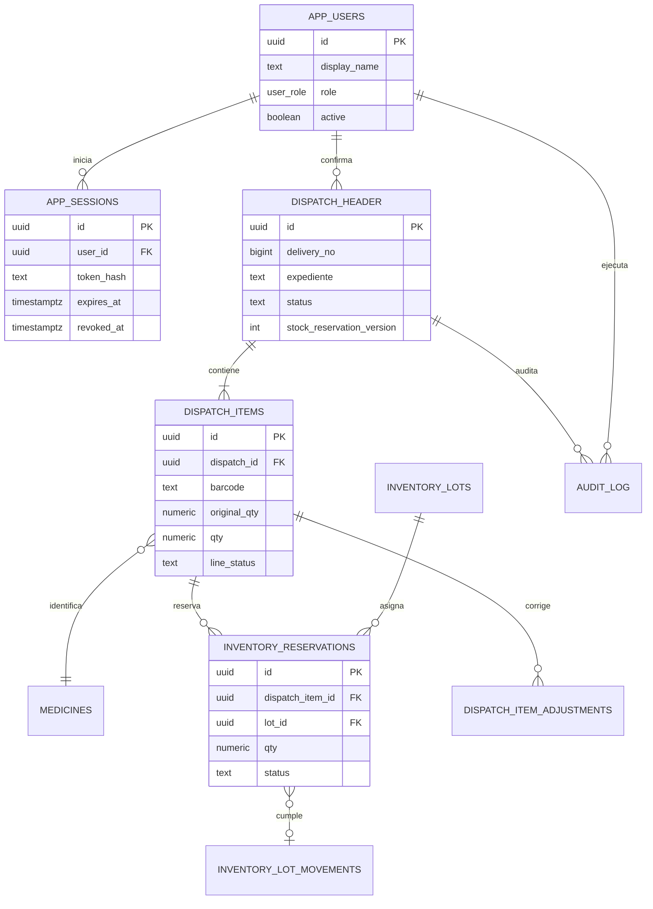
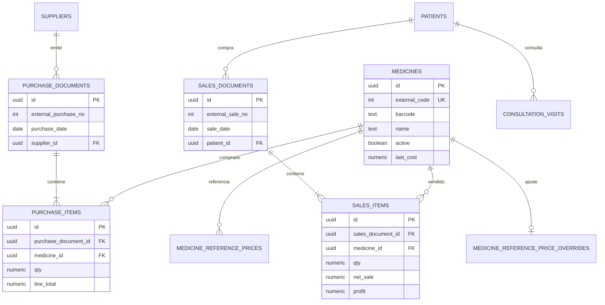
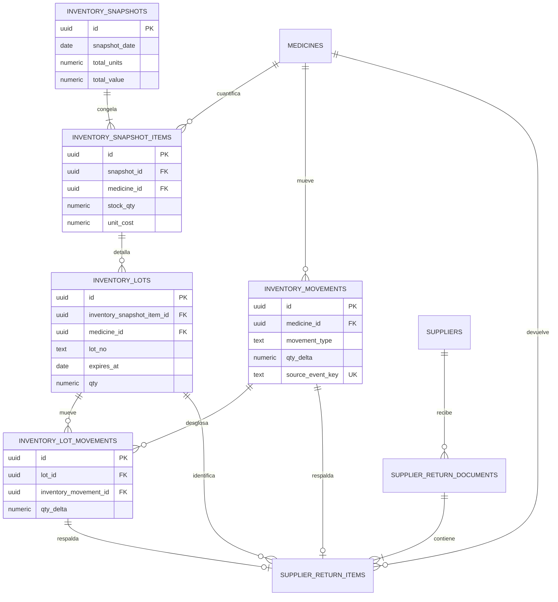
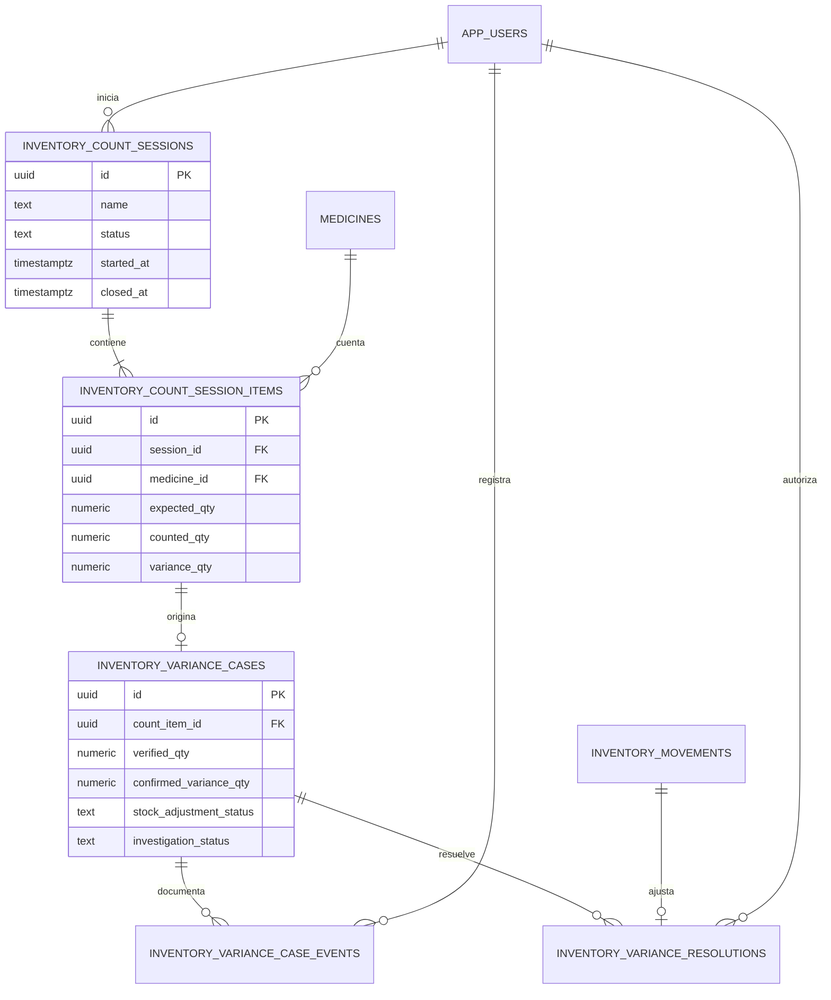
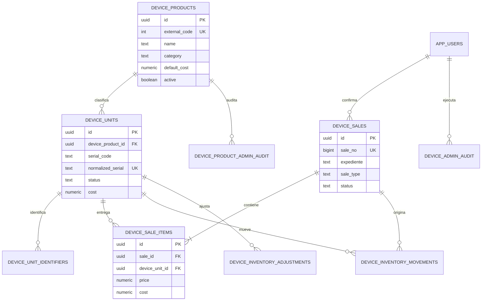
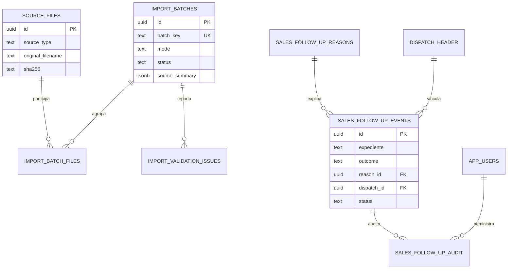
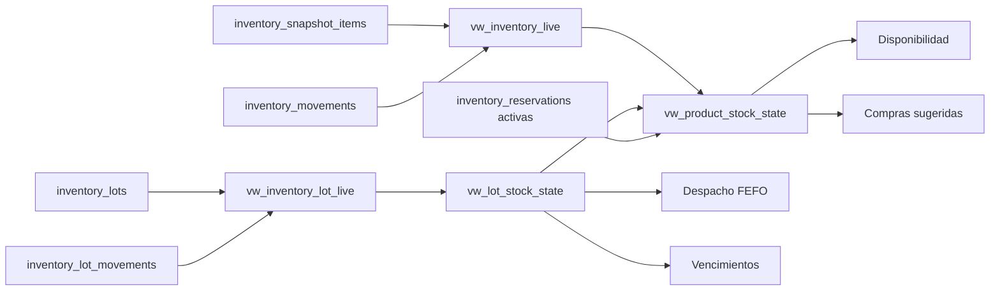

# Modelo entidad-relación

## Cómo leer los diagramas

Los diagramas se dividen por dominio para conservar legibilidad. Las entidades
operativas heredadas se incluyen porque son consumidas por las RPC actuales,
aunque su creación original no aparece en `001_pharma_core_schema.sql`.
Algunas uniones heredadas, como `dispatch_items` con `medicines`, son relaciones
lógicas por código de barras y no claves foráneas declaradas.

## 1. Identidad y despacho farmacéutico

## 2. Catálogo, compras, ventas y pacientes

## 3. Inventario, lotes y devoluciones

## 4. Conteos y resolución de diferencias

## 5. Dispositivos serializados

## 6. Importaciones y seguimiento comercial

## 7. Vistas derivadas

Las vistas no son nuevas fuentes de eventos; proyectan las entidades anteriores:

